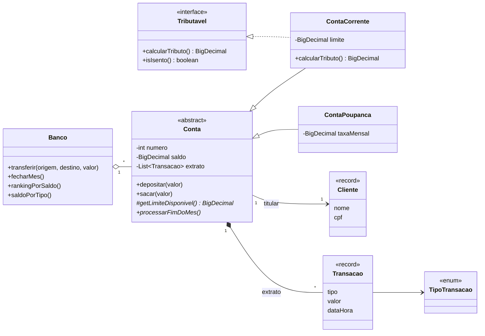

# Sistema Bancário — Programação Orientada a Objetos em Java

[](https://github.com/edufurlanetti/java-poo-sistema-bancario/actions/workflows/ci.yml)

Projeto didático que reúne, em um domínio conhecido de todos, os pilares da **Programação Orientada a Objetos** e recursos modernos do **Java 17**, com **testes automatizados** (JUnit 5) e **integração contínua** (GitHub Actions).

> Material das disciplinas de Programação Orientada a Objetos (ADS e Engenharia) — Prof. Eduardo Furlanetti.

## Diagrama de classes



## Conceitos demonstrados

| Conceito | Onde observar |
|---|---|
| **Encapsulamento** | `Conta`: saldo privado alterado só por métodos que validam regras; extrato exposto como lista imutável |
| **Herança** e **classe abstrata** | `Conta` → `ContaCorrente` e `ContaPoupanca` |
| **Polimorfismo** | `Banco.fecharMes()` chama `processarFimDoMes()` e cada conta aplica a sua regra |
| **Interface** com método `default` | `Tributavel` |
| **Template Method** | `Conta.sacar()` é `final` e delega o limite a `getLimiteDisponivel()` |
| **Exceções personalizadas** em hierarquia | `OperacaoInvalidaException` ← `SaldoInsuficienteException` |
| `record`, `enum` com atributos, `Optional` | `Cliente`, `Transacao`, `TipoTransacao`, `Banco.buscar()` |
| **Streams** e coletores | relatórios em `Banco` (`groupingBy`, `reducing`, `sorted`) |
| `BigDecimal` para dinheiro | todo o projeto (`double` gera erros de arredondamento) |
| **Testes unitários** | `src/test` — 17 testes JUnit 5 |

## Como executar

Requisitos: **JDK 17+** e **Maven 3.8+** (ou abra a pasta no IntelliJ IDEA, Eclipse ou VS Code).

```bash
mvn test                 # executa os testes
mvn compile exec:java    # executa a demonstração (App.java)
```

Saída da demonstração (trecho):

```
=== Contas após o fechamento do mês ===
Conta Poupança nº 2 | Ana Souza | saldo R$ 3015.00
Conta Corrente nº 1 | Ana Souza | saldo R$ 880.10
Conta Corrente nº 3 | Bruno Lima | saldo R$ -371.31
```

## Exercícios propostos

1. Crie a `ContaSalario`, que só aceita depósitos do empregador e permite no máximo 2 saques gratuitos por mês.
2. Faça `ContaPoupanca` implementar `Tributavel` (IR de 15% sobre o rendimento) e escreva os testes.
3. Adicione um `Pix` com chave (CPF, e-mail ou aleatória) usando uma `sealed interface ChavePix` (Java 17).
4. Persista as contas em arquivo CSV ou em banco de dados com JDBC.

## Licença

[MIT](LICENSE)
